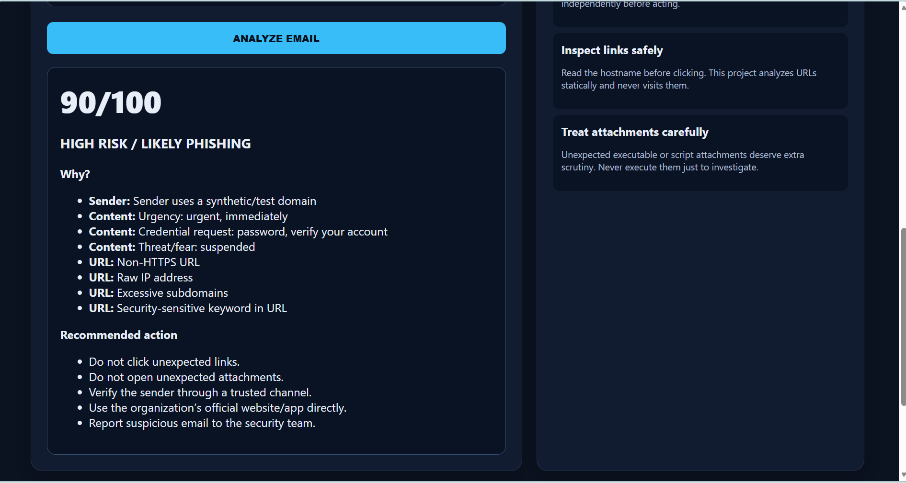
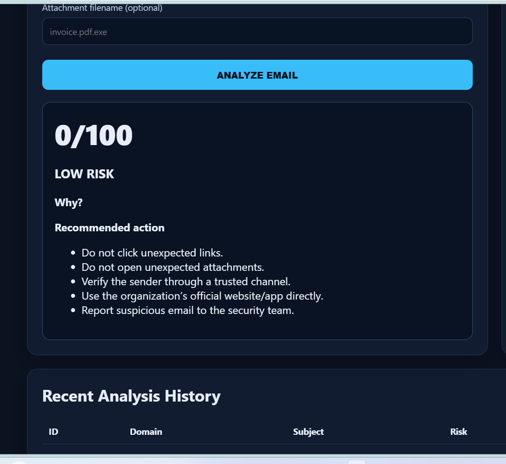
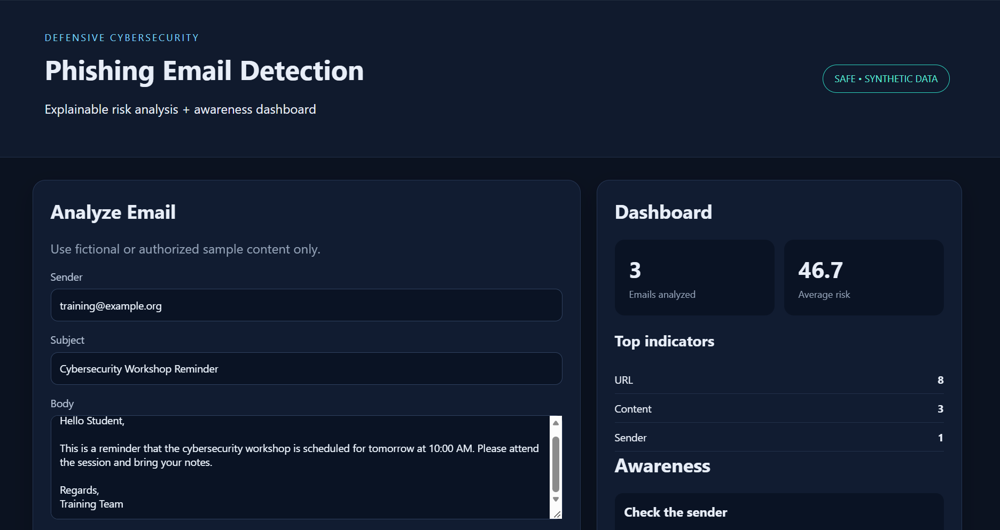
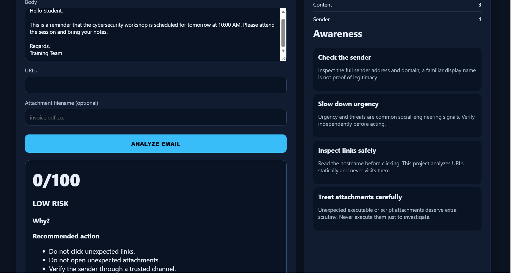

# Phishing Email Detection & Awareness Dashboard

A defensive cybersecurity dashboard for analyzing synthetic email content, sender patterns, URLs, attachment filenames, and social-engineering indicators to generate explainable phishing risk assessments.

## Features
- Sender, content, URL, and attachment analysis
- Explainable 0–100 phishing risk score
- SAFE/LOW/MODERATE/SUSPICIOUS/HIGH-RISK style outcomes
- SQLite analysis history and dashboard statistics
- Phishing-awareness lessons and checklist
- Synthetic 600-record dataset generator
- Optional TF-IDF + Logistic Regression model
- Automated tests

## Safe Design
Uses synthetic/authorized data only. It does not send phishing emails, collect credentials, execute attachments, or automatically visit suspicious URLs.

## Run Locally
```powershell
py -m venv .venv
.\.venv\Scripts\Activate.ps1
pip install -r requirements.txt
python data/generate_dataset.py
python backend/app.py
```
Open `http://127.0.0.1:5000`.

Optional ML:
```powershell
python ml/train_model.py
```
Tests:
```powershell
pytest -v
```

## Project Structure
`backend/` API and services · `frontend/` dashboard · `data/` synthetic data · `ml/` optional model · `tests/` automated tests · `docs/` architecture/security · `reports/` report.

## Screenshots

### Phishing Detection — High Risk


### Legitimate Email — Low Risk


### Dashboard Overview


### Security Awareness Module


## Disclaimer
This project is designed for cybersecurity education and defensive analysis using synthetic or authorized data.
